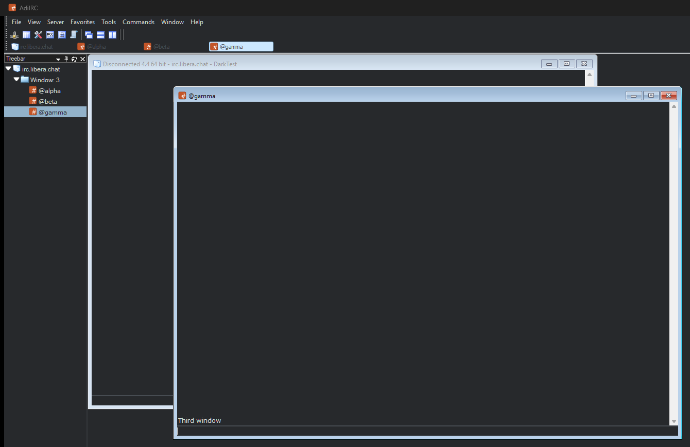
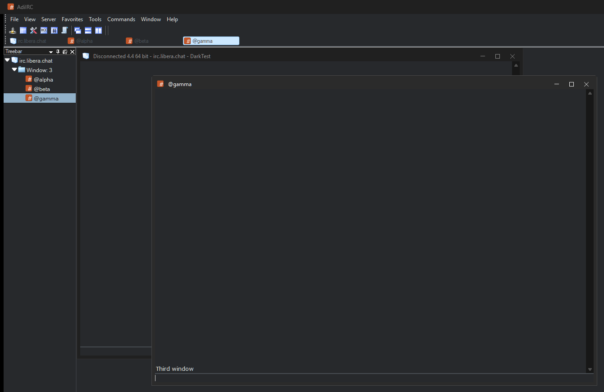

# DarkFrames for AdiIRC

An [AdiIRC](https://www.adiirc.com/) plugin that gives the channel, query and server windows dark title bars,
borders and scroll bars when Windows is in dark mode.

| Before | After |
|---|---|
|  |  |

## Why

AdiIRC's windows are MDI child windows. Windows has no dark style for their frames: the system dark title
bar only applies to top-level windows. So even with a dark AdiIRC theme and Windows in dark mode, every
channel window kept a light Windows 7 style title bar and border. AdiIRC's own "Use dark mode" option
doesn't change them.

DarkFrames paints those frames itself:

- dark title bars and borders, with a lighter bar for the active window and dimmed titles for inactive ones
- flat minimize, maximize/restore and close buttons, with hover and pressed states (red close on hover)
- dark scroll bars (the Windows dark scroll bar style)

It follows the Windows app mode (Settings > Personalization > Colors > Choose your app mode) and switches
live. In light mode it leaves everything to Windows, so the frames look exactly as before.

## Install

1. Download `DarkFrames.dll` from the [latest release](https://github.com/Taoism/adiirc-darkframes/releases/latest).
2. Put it in AdiIRC's `Plugins` folder:
   - portable AdiIRC: the `Plugins` folder next to `AdiIRC.exe` (create it if needed)
   - installed AdiIRC: `%LOCALAPPDATA%\AdiIRC\Plugins`
3. In AdiIRC, open File > Plugins, select DarkFrames and click Load. AdiIRC loads it again at every start.

If Windows blocks the downloaded file (AdiIRC then reports a network location error), right-click the dll,
open Properties, tick Unblock, and restart AdiIRC.

To remove it, unload it in File > Plugins and delete the dll.

## Options

An optional `DarkFrames.ini` next to the dll overrides the automatic mode:

```ini
[DarkFrames]
Mode=auto
```

`auto` follows Windows, `dark` always paints the dark frames, and `light` never does.

## Requirements

- AdiIRC 4.x with the plugin API v2 (tested with AdiIRC 4.4, 64-bit, on Windows 11)
- Windows 10 1809 or later (the dark app mode and dark scroll bars)

## Building

`build.cmd` compiles `src\DarkFrames.cs` with the .NET Framework 4 C# compiler that is part of Windows, so
nothing else needs to be installed. Pass the path to `AdiIRCAPIv2.dll`, which AdiIRC keeps in its config
folder:

```
build.cmd "C:\Program Files\AdiIRC\AdiIRCAPIv2.dll"
```

The plugin is written in C# 5 for that compiler. The output is `build\DarkFrames.dll`.

## How it works

Each MDI child window is subclassed with a `NativeWindow`. While dark mode is on, the plugin paints the
non-client area on `WM_NCPAINT`, `WM_NCACTIVATE` (letting Windows update the state without repainting) and
the undocumented `WM_NCUAHDRAWCAPTION`/`WM_NCUAHDRAWFRAME` messages that themed windows use to redraw their
captions, and hides the window from Windows while it handles `WM_SETTEXT` and `WM_SETICON`. It hit-tests and
tracks its own caption buttons and sends the matching `WM_SYSCOMMAND`. Moving, sizing and the system menu
are left to Windows. Scroll bars get the `DarkMode_Explorer` theme.

## License

[MIT](LICENSE)
